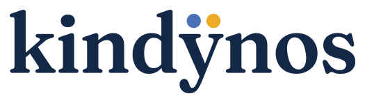

<p align="center">
  
</p>

<h1 align="center">
  <picture>
    <source media="(prefers-color-scheme: dark)" srcset="files/img/brand/kindynos-wordmark-dark.svg">
    
  </picture>
</h1>

<p align="center"><em>AI risk assessment with the taxonomies of the MIT AI Risk Repository.</em></p>

Kindynos (Greek κίνδυνος, "danger, risk") helps you assess the risks of an AI system. You answer 24
questions about the system; Kindynos finds its risks, classifies them with the taxonomies of the
[MIT AI Risk Repository](https://airisk.mit.edu/), says who or what causes each one, whether on purpose
and when, and builds an interactive report you can keep and share.

https://github.com/user-attachments/assets/350ff43d-87cf-4668-9cd5-b7e422967920

## What you get

- **A guided questionnaire** in English or Italian: 24 questions over the seven domains of AI risk, with
  follow-up questions where an answer calls for them. Your answers stay in your browser until you start
  the analysis.
- **The risks of your system**, grouped by the domains and subdomains of the MIT Domain Taxonomy, each with
  a severity, an explanation and a mitigation.
- **Their causes**, along the MIT Causal Taxonomy (entity, intent, timing), labeled by a small model that
  runs on your computer and says how confident it is of each label.
- **An overall picture**: a global risk score, the main concerns and recommendations, from expert rules
  written in Prolog.
- **A self-contained HTML report** with interactive charts and filters, light and dark themes, and the
  analysis data attached. It works offline.

## Quick start

You need [Docker](https://docs.docker.com/get-docker/) and a Google Gemini API key, free from
[Google AI Studio](https://aistudio.google.com/).

```bash
git clone https://github.com/6MicheleStingo9/kindynos.git
cd kindynos
cp .env.example .env        # then write your key in GOOGLE_API_KEY
docker compose up --build
```

Open http://localhost:8000 and start the questionnaire. When the analysis ends, after a few minutes, the
page shows the main results and the link to the report, which is also saved in `files/reports/`. On the first run Kindynos downloads its
causal model (615 MB) from Hugging Face.

Each assessment makes 2 requests to Gemini: its free tier allows about ten assessments a day.

### Without Docker

You need Python 3.11 or 3.12, [SWI-Prolog](https://www.swi-prolog.org/) (on Debian and Ubuntu,
`sudo apt install swi-prolog`) and [Node.js](https://nodejs.org/) 22, which builds the web interface.

```bash
python -m venv .venv && source .venv/bin/activate
pip install --index-url https://download.pytorch.org/whl/cpu torch==2.14.1   # CPU-only PyTorch, first
pip install -r requirements.txt -r requirements-laya.txt
(cd frontend && npm ci && npm run build)   # the web interface
uvicorn api.main:app
```

Every setting is described in [docs/configuration.md](docs/configuration.md).

## How it works

1. **Questionnaire.** You describe the system by answering 24 questions, each tied to a subdomain of
   the MIT Domain Taxonomy.
2. **Domain analysis.** An LLM (Gemini) reads the answers and writes the risks of each subdomain, with
   their severity and mitigation.
3. **Causal analysis.** A local model labels the entity, intent and timing of each risk.
4. **Heuristic analysis.** Prolog rules compute the risk score, the main concerns and the recommendations.
5. **Report.** The LLM writes an executive summary, and Kindynos builds the HTML report.

More in [docs/how-it-works.md](docs/how-it-works.md).

## The causal model and its data

The causal labels come from **laya-kindynos-causal**,
[Laya-multilingual](https://huggingface.co/convaiinnovations/laya-multilingual) fine-tuned on the MIT AI
Risk Repository and on risks written by Kindynos. On 145 test risks whose labels a person verified, it
gets the entity right 88% of the time, the intent 77% and the timing 95%. Model, data and training are
public:

| | Hugging Face | Kaggle |
|---|---|---|
| Model (Apache-2.0) | [MicheleStingo/laya-kindynos-causal](https://huggingface.co/MicheleStingo/laya-kindynos-causal) | [michelestingo/laya-kindynos-causal](https://www.kaggle.com/models/michelestingo/laya-kindynos-causal) |
| Data (CC BY 4.0) | [MicheleStingo/kindynos-causal-risks](https://huggingface.co/datasets/MicheleStingo/kindynos-causal-risks) | [michelestingo/kindynos-causal-risks](https://www.kaggle.com/datasets/michelestingo/kindynos-causal-risks) |
| Training | [training/](training/README.md) | [notebook](https://www.kaggle.com/code/michelestingo/kindynos-fine-tuning-laya-to-label-ai-risks) |

## Documentation

- [How it works](docs/how-it-works.md): the questionnaire, the four analysis steps and the report.
- [The MIT taxonomies](docs/taxonomies.md): the domains and causes of AI risk that Kindynos assesses.
- [Configuration](docs/configuration.md): settings, Gemini quota, Docker, the causal model at run time.
- [Development](docs/development.md): project structure, running single agents, tests.
- [Training the causal model](training/README.md) and [evaluation](evaluation/README.md).

## License and credits

Kindynos is released under the [MIT License](LICENSE). It was formerly called AREA (Automatic Risk
Evaluation Analysis).

It builds on the [MIT AI Risk Repository](https://airisk.mit.edu/) and its taxonomies (CC BY 4.0):

> Slattery, P., Saeri, A. K., Grundy, E. A. C., Graham, J., Noetel, M., Uuk, R., Dao, J., Pour, S.,
> Casper, S., & Thompson, N. (2024). *The AI Risk Repository: A Comprehensive Meta-Review, Database, and
> Taxonomy of Risks from Artificial Intelligence.* https://doi.org/10.48550/arXiv.2408.12622

The causal model is fine-tuned from [Laya-multilingual](https://huggingface.co/convaiinnovations/laya-multilingual)
(Apache-2.0).
