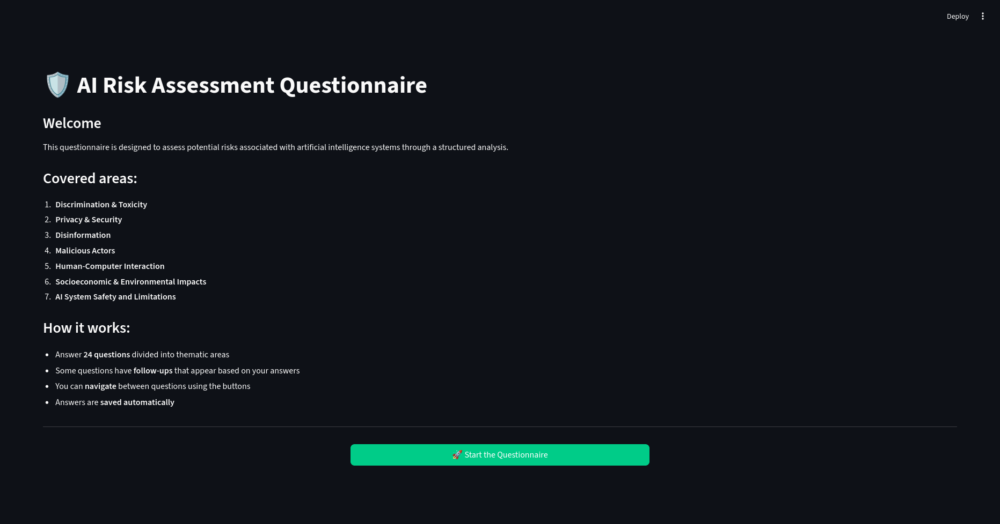
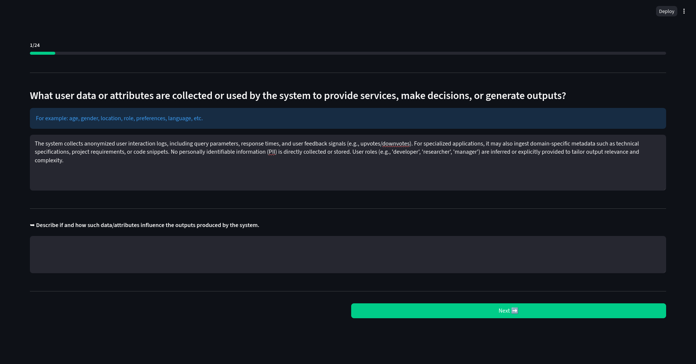

<p align="center">
  
</p>

<h1 align="center">
  <picture>
    <source media="(prefers-color-scheme: dark)" srcset="files/img/brand/kindynos-wordmark-dark.svg">
    
  </picture>
</h1>

<p align="center"><em>AI risk assessment with the taxonomies of the MIT AI Risk Repository.</em></p>

Kindynos (Greek κίνδυνος, "danger, risk", the root of *cindynics*, the science of danger) is a LangGraph-based MAS platform for assessing risks associated with AI systems. It uses a user-driven questionnaire and a multi-agent workflow for risk analysis and report generation, providing a user-friendly interface with multilingual support.

> Formerly AREA (Automatic Risk Evaluation Analysis). Some internal names keep that prefix: `evaluation/area_testset/`, `files/data/area_trainset/`, the `--area` options and the `area_*` data files.

## Table of Contents

1. [Scientific Foundations](#scientific-foundations)
2. [Architecture](#architecture)
3. [Project Structure](#project-structure)
4. [Requirements](#requirements)
5. [Installation & Setup](#installation--setup)
6. [Usage](#usage)
   - [Start the web interface (FastAPI)](#start-the-web-interface-fastapi)
   - [Standalone Execution of Agents](#standalone-execution-of-agents)
7. [Analysis Workflow](#analysis-workflow)
8. [Output & Results](#output--results)
9. [Customization & Advanced Usage](#customization--advanced-usage)
10. [License](#license)
11. [References](#references)

---

## Scientific Foundations

Kindynos is grounded in the scientific work of the [MIT Risk AI Repository](https://airisk.mit.edu/) - [Slattery et al., 2024](#references), leveraging two complementary taxonomies to systematically assess risks associated with AI systems:

### 1. Domain Taxonomy of AI Risks

This taxonomy catalogs the types of hazards and harms that can arise from AI systems. Each question in the Kindynos questionnaire is mapped to a specific domain and subdomain, allowing for a structured risk assessment.

**Main domains and example subdomains:**

| Domain                                   | Subdomain                                   | Description (short)                                                      |
| ---------------------------------------- | ------------------------------------------- | ------------------------------------------------------------------------ |
| Discrimination & Toxicity                | Unfair discrimination and misrepresentation | Unequal treatment or misrepresentation based on sensitive attributes     |
|                                          | Exposure to toxic content                   | AI exposes users to harmful, abusive, or inappropriate content           |
| Privacy & Security                       | Privacy compromise                          | AI leaks or infers sensitive information                                 |
|                                          | System security vulnerabilities             | Vulnerabilities leading to unauthorized access or unsafe behavior        |
| Misinformation                           | False or misleading information             | AI generates or spreads incorrect or deceptive information               |
| Malicious actors & misuse                | Disinformation, surveillance, influence     | Large-scale manipulation, surveillance, or propaganda                    |
| Human-computer interaction               | Overreliance and unsafe use                 | Users trust or rely on AI inappropriately, risking autonomy or safety    |
| Socioeconomic & environmental harms      | Power centralization, inequality, etc.      | AI increases inequality, centralizes power, or causes environmental harm |
| AI system safety, failures & limitations | Lack of robustness, transparency, etc.      | AI fails, is not interpretable, or develops dangerous capabilities       |

**Example:**  
_Question 1.1 (“What user data or attributes are collected or used by the system…?”) is mapped to “Discrimination & Toxicity > Unfair discrimination and misrepresentation”. The user’s answer helps assess if the system could treat groups unfairly based on collected data._

### 2. Causal Taxonomy of AI Risks

After the initial domain-based assessment, Kindynos analyzes the underlying causes of each risk using the Causal Taxonomy, which classifies risks along three axes:

| Category | Levels                                 | Description                                                             |
| -------- | -------------------------------------- | ----------------------------------------------------------------------- |
| Entity   | Human, AI, Other                       | Who/what is the main cause of the risk (e.g., human error, AI decision) |
| Intent   | Intentional, Unintentional, Other      | Whether the risk is the result of a deliberate action or an accident    |
| Timing   | Pre-deployment, Post-deployment, Other | When the risk occurs in the AI lifecycle (before or after deployment)   |

**Example:**  
_If a risk is identified as “AI system generates biased outputs due to poor training data”, the Entity may be `Human` (for data selection), Intent `Unintentional`, and Timing `Pre-deployment`._

## Architecture

Kindynos is built as a modular, multi-agent system orchestrated via [LangGraph](https://github.com/langchain-ai/langgraph). Each main analysis step is handled by a specialized agent, enabling clear separation of concerns and extensibility. The workflow is as follows:

- **Orchestration:** LangGraph manages the execution flow, coordinating the sequence and data exchange between agents.
- **Agents:**
  - **Domain Risk Analyzer Agent (LLM-based):** Assesses risks for each questionnaire answer using the Domain Taxonomy, leveraging a large language model for reasoning and classification.
  - **Causality Analyzer Agent (local classifier):** Determines the underlying causes of each risk (Entity, Intent, Timing) with Laya, a small model fine-tuned for this task that runs on the CPU and gives a calibrated confidence per label; an LLM can do it instead ([Causal classification](#causal-classification-laya)).
  - **Heuristic Analyzer Agent (Prolog-based):** Applies expert rules for advanced risk inference.
  - **Report Generator Agent (LLM-based):** Synthesizes results and generates the final HTML report, using an LLM for natural language generation and summary.

**Architecture Diagram:**



**Key points:**

- Domain and (partially) Report generation steps are powered by LLMs; the causality step runs locally, or with the LLM if configured.
- The agent-based design allows for easy extension and integration of new analysis modules.
- LangGraph ensures robust, maintainable, and transparent orchestration of the entire workflow.

---

## Project Structure

The Kindynos repository is organized as follows:

- `agents/` — All analysis and generator agents:
  - `orchestrator.py`: pipeline controller
  - `domain_analyzer/`, `causality_analyzer/`, `heuristic_analyzer/`, `report_generator/`: modular agent implementations
- `files/` — All data and results:
  - `questions_*.json`: questionnaire definitions (EN/IT)
  - `answers/`: user answers
  - `analysis/`: intermediate results (domain, causality, heuristic)
  - `reports/`: generated HTML reports and metadata
  - `img/brand/`: logo, mascot and social preview ([README](files/img/brand/README.md))
- `api/` — FastAPI web layer:
  - `main.py`: app entry point (mounts static assets, includes routers)
  - `routes_quiz.py`, `routes_run.py`: questionnaire and pipeline/report endpoints
  - `jobs.py`, `sessions.py`: in-memory job and session registries
  - `templates/`: Jinja2 templates (htmx-enhanced)
  - `static/`: CSS and vendored htmx
- `quiz/` — Streamlit-free questionnaire logic shared by the web layer:
  - `logic.py`: load/validate/save answers, follow-up evaluation
  - `translations.py`: UI translations and the `t()` helper
- `utils/` — Common models and utility functions
- `Dockerfile`, `docker-compose.yml`, `.dockerignore` — containerization
- `requirements.txt` — Python dependencies; `requirements-laya.txt` — the local causal classifier (Laya)
- `training/` — fine-tuning of the causal classifier (checkpoints in `training/checkpoints/`, not versioned)
- `README.md` — Project documentation
- `.env` — API key and model configuration (not versioned)

---

## Requirements

- Python 3.10+
- See `requirements.txt` for dependencies

---

## Installation & Setup

### API Key and Model Configuration

To use Kindynos, you need access to a Google Gemini model. Before running the application, create a `.env` file in the project root with the following content:

```env
GOOGLE_API_KEY=your_api_key_here
GEMINI_MODEL=gemini-2.5-flash
```

- Replace `your_api_key_here` with your API key from [Google AI Studio](https://aistudio.google.com/).
- You can set `GEMINI_MODEL` to the specific Gemini model you want to use (e.g., `gemini-2.5-flash`).
- Each assessment makes 2 LLM requests (domain, report) with the local causal classifier, 3 with
  `CAUSALITY_BACKEND=llm`. The Gemini API free tier has a daily request quota per model (20 for
  `gemini-2.5-flash` as of October 2026), so it allows about ten assessments a day; past the quota,
  requests fail with `429 RESOURCE_EXHAUSTED` until it resets.

> Get your API key and see available models at: https://aistudio.google.com/

#### Install dependencies

```bash
git clone <repo-url>
cd area
python -m venv .venv
source .venv/bin/activate
pip install -r requirements.txt
# the local causal classifier (Laya): CPU-only PyTorch first, then the rest
pip install --index-url https://download.pytorch.org/whl/cpu torch==2.14.1
pip install -r requirements-laya.txt
```

### Causal classification (Laya)

The causality step labels each risk with `laya-causal-v4`, a [Laya-multilingual](https://huggingface.co/convaiinnovations/laya-multilingual)
checkpoint fine-tuned for this task ([Training (Laya)](#training-laya)), on the CPU and without API calls.
On the Kindynos test set it is at least on par with the Gemini pipeline on every axis, in accuracy and
macro-F1, and better on entity, intent macro-F1 and timing accuracy
([comparison](evaluation/results/comparison.md)).

- The checkpoint is read from `training/checkpoints/laya-causal-v4` (615 MB, not versioned).
  `LAYA_MODEL` points to another directory or to a Hugging Face id, `LAYA_REVISION` pins its revision.
- The model loads once per process (6–9 s) and labels a risk in about 2 s on a laptop CPU (i7-1255U,
  1.4–2.6 s): under a minute for an assessment of 20 risks, in Docker too.
- Laya writes no text: in the report each label comes with the MIT definition of its value and Laya's
  confidence, the calibrated probability of that value. Labels below 90% confidence are marked ⚠, to
  be checked, with the next most likely value. The threshold was chosen on Kindynos runs held out from
  training (the test set was not used): there, the labels below it were 59% correct, the others 94%.
  On the test set, measured once afterwards, 4.6% of the labels are flagged and half of them are
  wrong, against 11% of the others. Most errors are confident ones, so the flag points out doubtful
  labels but does not catch every mistake. `LAYA_REVIEW_THRESHOLD` changes it.
- The causality step gives exactly the labels that were evaluated: on the 145 test risks, all 435
  labels match those scored in `evaluation/results/` (computed on a GPU), with probabilities within 0.01.
- `CAUSALITY_BACKEND=llm` has the LLM label the causality instead, with rationales it writes (one more
  request per assessment). Without the checkpoint or its packages, the default backend stops the run
  with an error that says how to fix it: it does not switch to the LLM on its own.

---

## Docker

The fastest way to run Kindynos is via Docker (no local Python or SWI-Prolog setup needed).

```bash
# 1. Copy and fill in your API key
cp .env.example .env   # or create .env manually

# 2. Build and start
docker compose up --build
```

The application is available at `http://localhost:8000`.
The image includes CPU-only PyTorch for the causal classifier, but not its checkpoint: `./training`
is mounted read-only, so the container uses `training/checkpoints/laya-causal-v4` from the host
([Causal classification](#causal-classification-laya)).
Answers and reports are persisted in `./files/` via a bind mount. The container runs as
UID/GID 1000 so the files stay editable on the host; if your user has different ids, set
`UID` and `GID` in `.env` (e.g. `UID=1001`).

### Required `.env`

```env
GOOGLE_API_KEY=your_api_key_here
GEMINI_MODEL=gemini-2.5-flash
# Optional: the LLM labels the causality instead of the local Laya model
# CAUSALITY_BACKEND=llm
```

---

## Usage

### Start the web interface (FastAPI)

```bash
uvicorn api.main:app --reload
```

Open `http://localhost:8000` in your browser.

### Standalone Execution of Agents

Each agent can be run individually from the terminal for testing or advanced analysis. Run the commands as modules from the project root (`python -m ...`), so that the `agents` and `utils` packages are importable. Here are some example commands:

- **Generate sample questionnaire answers**  
   You can generate simulated answers for a questionnaire (useful for tests or demos) with the questionnaire_generator agent:

  ```bash
  python -m agents.questionnaire_generator.question_generator_agent questions_en.json --profile expert
  ```

  The agent simulates a user filling out the questionnaire, using the selected profile to generate realistic answers. The profile can be `expert`, `intermediate`, or `beginner`.

- **Domain Risk Analysis (Domain Analyzer)**  
   Analyze an answers file (for example, generated in the previous step):

  ```bash
  python -m agents.domain_analyzer.domain_risk_analyzer_agent --run_id <run_id>
  ```

  or

  ```bash
  python -m agents.domain_analyzer.domain_risk_analyzer_agent answers_12345.json
  ```

- **Causality Analysis (Causality Analyzer)**  
   Analyze a domain analysis file, with the configured backend (`CAUSALITY_BACKEND`):

  ```bash
  python -m agents.causality_analyzer.causality_risk_analyzer_agent domain_analysis_12345.json
  ```

- **Heuristic Analysis (Heuristic Analyzer)**  
   Analyze a causality analysis file:

  ```bash
  python -m agents.heuristic_analyzer.heuristic_risk_analyzer_agent causality_analysis_12345.json
  ```

- **Final Report Generation (Report Generator)**  
   Generate the HTML report from a heuristic analysis file:

  ```bash
  python -m agents.report_generator.report_generator_agent heuristic_analysis_12345.json
  ```

  Input and output files are located in their respective folders under `files/`.  
  For more details on available parameters, see the agent source code in `agents/`.

### Tests

Unit tests (no LLM calls) run with pytest from the project root:

```bash
pip install -r requirements-dev.txt
pytest
```

### Evaluation

The [MIT AI Risk Repository](files/data/README.md) (CC BY 4.0) provides expert labels for both
taxonomies. `files/data/processed/` holds the extracted datasets with a frozen train/eval split;
the causal classification baseline measures how well the LLM assigns Entity / Intent / Timing to
the eval risks (accuracy and macro-F1 with 95% bootstrap intervals):

```bash
python data_prep/extract_dataset.py        # rebuild files/data/processed/ (+ manifest.json)
python -m evaluation.causal_baseline       # results in evaluation/results/ (calls the LLM)
```

Progress is saved after every LLM call: if a run stops (e.g. on the Gemini free tier daily quota),
rerunning the same command resumes it.

A second, in-distribution test set uses risks written by Kindynos itself: simulated questionnaires for each
profile and language, analyzed by the domain and causality agents. Its gold labels are added by hand,
following [evaluation/area_testset/LABELING.md](evaluation/area_testset/LABELING.md):

```bash
python -m evaluation.area_testset generate   # questionnaires + domain/causality analyses (calls the LLM)
python -m evaluation.area_testset collect    # one row per risk in evaluation/area_testset/risks.jsonl
python -m evaluation.area_testset evaluate   # pipeline labels vs labels.jsonl, results in evaluation/results/
```

Two classifiers are compared on the same risks with a paired bootstrap: per axis, the difference in
accuracy and in macro-F1 with its 95% interval, and a verdict (better, on par, worse):

```bash
python -m evaluation.paired <results file> pipeline   # e.g. a Laya run against the Kindynos pipeline labels
python -m evaluation.compare                          # every run side by side, in evaluation/results/comparison.md
```

### Training (Laya)

The causal classifier is [Laya-multilingual](https://huggingface.co/convaiinnovations/laya-multilingual)
(Apache-2.0, 322M parameters, typed decisions with calibrated probabilities), fine-tuned on the MIT training
split and on risks written by Kindynos; the checkpoint chosen, `laya-causal-v4`, is the one the causality step
uses. Training has its own environment:

```bash
python -m venv .venv-train
.venv-train/bin/pip install --index-url https://download.pytorch.org/whl/cpu torch==2.14.1
.venv-train/bin/pip install -r requirements-train.txt
.venv-train/bin/python -m training.build_laya_data     # training/data/: one row per risk (subdomain, title, text), three typed questions
.venv-train/bin/python -m training.evaluate_laya --model <checkpoint> --name <slug>   # both test sets
```

Laya reads each risk with its subdomain in the MIT Domain Taxonomy: Kindynos writes its risks per
subdomain, and the MIT labels follow conventions that differ by subdomain. Variants are trained on the
MIT training split without its validation groups (`causal_fit.jsonl`), calibrated on those groups
(`causal_val.jsonl`) and compared on them with `training.select_laya`, which keeps only the variants
Laya can calibrate (fitted temperature below its cap) and picks the best mean macro-F1; only the
chosen one is evaluated on the test sets.

MIT-only training does not learn how Kindynos frames its risks, so Kindynos also writes training risks of
its own, for 28 simulated systems unlike those of the test set, labelled by Claude subagents with the
rules of the test set ([files/data/area_trainset/](files/data/area_trainset/README.md)):

```bash
python -m data_prep.area_trainset generate   # questionnaire + domain analysis per run (calls the LLM, resumable)
python -m data_prep.area_trainset collect    # then batches / disagreements / merge for the labels
```

With `--area`, `training.finetune_laya` adds them to the training rows and calibrates on six Kindynos runs
held out (`area_val.jsonl`), and `training.select_laya --val area` compares the variants on those runs. Fine-tuning needs a GPU (about 15 hours on a laptop CPU):
[training/kaggle_finetune.ipynb](training/kaggle_finetune.ipynb) runs the whole loop on Kaggle (GPU,
Internet on), or run `python -m training.finetune_laya --device cuda` per variant.

---

## Analysis Workflow

The analysis workflow in Kindynos consists of the following steps:

1. **Questionnaire Compilation**
   - The user answers a set of structured questions, each mapped to a specific domain and subdomain of AI risk.
   - The questionnaire is available in multiple languages and covers all relevant risk areas.
     [Insert screenshot here: Example of the questionnaire UI]
2. **Domain Risk Analysis (LLM Agent)**
   - For each answer, a dedicated agent powered by a large language model evaluates the associated risk using the Domain Taxonomy.
   - This phase identifies which types of hazards (e.g., discrimination, privacy, misinformation) are most relevant to the described AI system.
3. **Causality Analysis (local classifier)**
   - Each identified risk is classified by Laya, a fine-tuned local model, along the Causal Taxonomy (Entity, Intent, Timing), with a confidence per label; uncertain labels are marked for review in the report. With `CAUSALITY_BACKEND=llm` an LLM does it instead.
   - This step helps clarify whether the risk is due to human actions, AI behavior, or other factors, and whether it is intentional or accidental.
4. **Heuristic Analysis (Prolog-based Agent)**
   - After the domain and causality analyses, Kindynos performs a heuristic risk analysis using a set of expert rules implemented in Prolog. This phase is crucial for several reasons:
     - **Expert Knowledge Integration:** Heuristic rules allow the system to encode domain expertise, regulatory requirements, and best practices that go beyond what is captured by the taxonomies alone.
     - **Logical Inference:** Using Prolog, Kindynos can infer complex risk patterns, aggregate risk metrics, and identify critical issues that may not be evident from individual answers. The rules operate on facts derived from the previous analyses (e.g., risk severity, causality attributes).
     - **Customizability:** The heuristic ruleset is fully extensible. Advanced users can add or modify rules in the `agents/heuristic_analyzer/rules.pl` file to tailor the analysis to specific domains, regulations, or organizational needs.
     - **What the heuristic analysis adds:**
       - Computes a global risk score and qualitative risk level (e.g., critical, high, medium, low).
       - Identifies the primary concern (e.g., AI dominance, operational issues, active threats).
       - Provides actionable recommendations and highlights domains requiring urgent attention.
       - Supports advanced features such as risk trend analysis, interdependency mapping, and scenario-based scoring (customizable by extending the rules).
     - This phase ensures that the final report is not just a list of risks, but a structured, prioritized, and actionable assessment.
5. **Report Generation (LLM Agent)**
   - The generated report includes:
     - Header: title, subtitle, download/view options, links to taxonomy sources
     - Executive summary: key findings and overall risk level
     - Key metrics: number of risks, domains, global risk score, risk level
     - Visualizations: interactive charts and tables (e.g., risk distribution, severity)
     - Detailed analysis: risks by domain/subdomain, causality breakdown, heuristic findings and alerts
     - Appendix: metadata, full analysis, and heuristic data (viewable/downloadable as JSON)
   - The report language matches the initial questionnaire language and is not user-customizable at runtime.
      <p align="center">
     
     
   </p>

---

## Output & Results

- You can find the results of each analysis step (domain, causality, heuristic) as JSON files in the `files/analysis/` subfolders.
- The final HTML report is saved in `files/reports/` and can be opened with your browser.

---

## Customization & Advanced Usage

- The heuristic ruleset can be extended or modified by editing `agents/heuristic_analyzer/rules.pl`.
- Advanced users can add new agents or modify the workflow by editing the orchestrator and agent modules in `agents/`.
- For further customization, refer to the code and comments in the repository.

## License

This project is licensed under the MIT License. See the [LICENSE](LICENSE) file for details.

## References

This project builds upon the scientific work of:

Slattery, P., Saeri, A. K., Grundy, E. A. C., Graham, J., Noetel, M., Uuk, R., Dao, J., Pour, S., Casper, S., & Thompson, N. (2024).  
The AI Risk Repository: A Comprehensive Meta-Review, Database, and Taxonomy of Risks from Artificial Intelligence.  
https://doi.org/10.48550/arXiv.2408.12622
