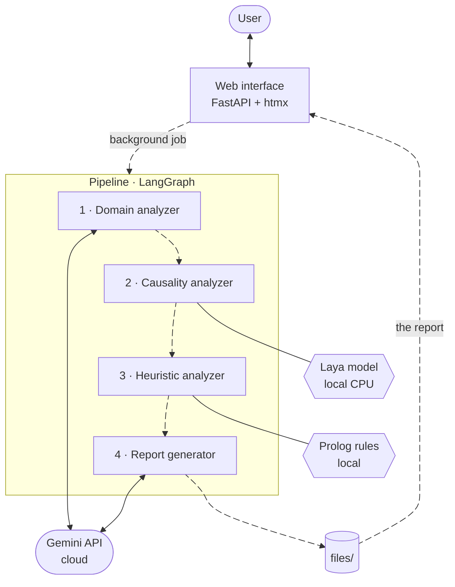

# Development

## Setup and tests

Install Kindynos as in the README ([without Docker](../README.md#without-docker)), then the development
packages, and run the unit tests from the project root:

```bash
pip install -r requirements-dev.txt   # pytest, and openpyxl for data_prep/extract_dataset.py
pytest
```

The tests make no LLM calls. One of them checks that the causality step gives the evaluated labels; it
runs only when the local checkpoint of the causal model and its packages are there.

## Architecture

The web interface starts each analysis as a background job. The four agents run in turn, each with its
own engine: Gemini for the domain analysis and the summary, the Laya model on the CPU for the causes, the
Prolog rules for the heuristics. The report goes to `files/`, where the web interface finds it.



## Project structure

| Path | Content |
|---|---|
| `agents/` | the pipeline: `orchestrator.py` and one folder per agent (`domain_analyzer/`, `causality_analyzer/`, `heuristic_analyzer/`, `report_generator/`); `questionnaire_generator/` simulates a user who fills in the questionnaire |
| `api/` | the web interface (FastAPI): routes, Jinja2 templates with htmx, static files, sessions and the state of the analyses |
| `quiz/` | the questionnaire logic (loading, validation, follow-ups, saving) and the interface translations |
| `utils/` | shared code: `paths.py` (where Kindynos keeps its files), `utils.py` (LLM client and logging), `models.py` (the schemas of the analyses), `brand.py` (the logo in pages and reports) |
| `files/` | the questionnaires (`questions_*.json`), the outputs of each run, the MIT data ([`data/`](../files/data/README.md)) and the logo ([`img/brand/`](../files/img/brand/README.md)) |
| `data_prep/` | the extraction of the MIT datasets and the generation of Kindynos training risks |
| `evaluation/` | test sets, evaluation scripts and results ([README](../evaluation/README.md)) |
| `training/` | the fine-tuning of the causal model ([README](../training/README.md)) |
| `publish/` | the builder of the Hugging Face repositories of the model and the data |
| `docs/` | this documentation |
| `tests/` | the unit tests |

Kindynos was formerly called AREA, and some internal names keep that prefix: `evaluation/area_testset/`,
`files/data/area_trainset/`, the `--area` options and the `area_*` data files.

## Running a single agent

The whole pipeline, or each agent, also runs from the terminal. Run the commands as modules from the
project root (`python -m ...`), so that the packages are importable. Inputs and outputs are in their folders
under `files/` ([where the results go](how-it-works.md#where-the-results-go)).

```bash
# The whole pipeline on an answers file in files/answers/
python -m agents.orchestrator answers_<run_id>.json

# Or one step at a time
python -m agents.domain_analyzer.domain_risk_analyzer_agent --run_id <run_id>     # or answers_<run_id>.json
python -m agents.causality_analyzer.causality_risk_analyzer_agent domain_analysis_<run_id>.json
python -m agents.heuristic_analyzer.heuristic_risk_analyzer_agent causality_analysis_<run_id>.json
python -m agents.report_generator.report_generator_agent heuristic_analysis_<run_id>.json
```

The causality step uses the configured backend (`CAUSALITY_BACKEND`, [configuration](configuration.md)).
For tests and demos, the questionnaire generator writes the answers of a simulated user, with the profile
`expert`, `intermediate` or `beginner` (one LLM request):

```bash
python -m agents.questionnaire_generator.question_generator_agent questions_en.json --profile expert
```

## Publishing the model and the data

`python -m publish.export_hf` builds the Hugging Face repositories of the causal model and its dataset in
`publish/build/`, and checks that every row matches the training data.
