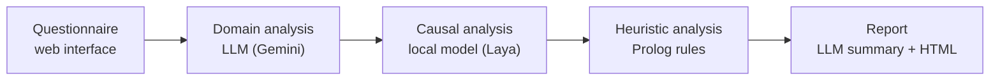
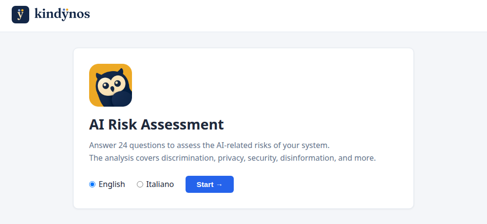
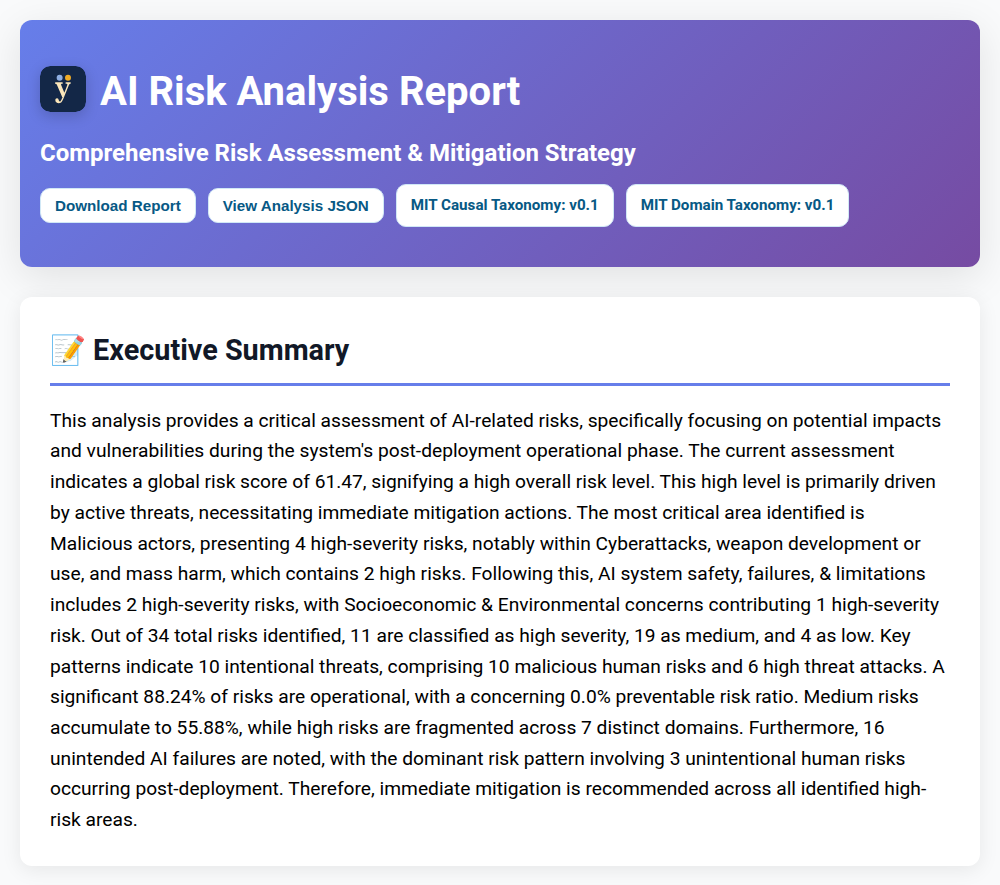

# How Kindynos works

Kindynos is a web questionnaire, built with FastAPI and htmx, in front of a pipeline of four agents
orchestrated with [LangGraph](https://github.com/langchain-ai/langgraph). Each agent passes its output to
the next and also saves it in `files/analysis/`, so every step can be run on its own from the saved files
([development](development.md#running-a-single-agent)).

## 1. Questionnaire

24 questions in English or Italian (`files/questions_en.json`, `files/questions_it.json`), each tied to a
subdomain of the MIT Domain Taxonomy ([the taxonomies](taxonomies.md)). Some answers open follow-up
questions. The interface also works without JavaScript. The answers are saved in `files/answers/`.

## 2. Domain analysis (LLM)

The domain analyzer sends the questions and answers to an LLM (Gemini), which replies following a JSON
schema. For each subdomain it writes the risks the answers point to, each with a title, an explanation, a
severity (low, medium or high) with its rationale, and a mitigation. Output: `files/analysis/domain/`.

## 3. Causal analysis (local model)

Each risk is labeled along the three axes of the MIT Causal Taxonomy: who or what causes it (entity),
whether the harm is intended (intent) and when it occurs (timing). The labels come from
[laya-kindynos-causal](https://huggingface.co/MicheleStingo/laya-kindynos-causal), a small model that runs
on the CPU, in about 2 seconds per risk on a laptop. It reads the subdomain, the title and the explanation
of the risk, and gives a calibrated probability for each value.

In the report each label carries the MIT definition of its value and the model's confidence. Labels below
90% confidence are flagged ⚠, with the next most likely value. An LLM can label the causes instead
([configuration](configuration.md#the-causal-model)). Output: `files/analysis/causality/`.

## 4. Heuristic analysis (Prolog)

Expert rules written in Prolog (`agents/heuristic_analyzer/rules.pl`) reason on the facts from the previous
steps, such as the severity and the causes of each risk. They:

- compute a global risk score and a risk level (critical, high, medium or low);
- identify the primary concern, for example active threats or operational issues;
- flag the domains that need urgent attention and recommend actions;
- find patterns across the risks, such as how many are intentional threats or unintended AI failures.

The rules encode knowledge that the taxonomies alone do not capture, and they can be extended
([below](#extending-kindynos)). Output: `files/analysis/heuristic/`.

## 5. Report (LLM and HTML)

The LLM writes an executive summary from the heuristic results, then Kindynos builds an HTML report in the
language of the questionnaire:

- **header**: download and view buttons, the versions of the MIT taxonomies;
- **executive summary** and **key metrics**: the number of risks, the global score and risk level, how the
  risks divide by severity and by cause;
- **charts**: the risks by domain, the flows between causes, the risk patterns, the alerts;
- **detailed analysis**: the risks by domain and subdomain, each with the question and answer it comes
  from, its explanation, mitigation and causal labels, with filters by severity and cause;
- **appendix**: the data of the analysis, as JSON.

The report embeds its scripts, styles and charting library: it opens offline, from the disk or from the web
interface, and follows the light or dark theme of the system. *Download Report* saves it with its metadata
as a ZIP. Output: `files/reports/`.

## Where the results go

All the files of a run share its id, from `answers_<run_id>.json` to `ai_risk_report_<run_id>.html`.

| Folder | Content |
|---|---|
| `files/answers/` | the answers of each questionnaire |
| `files/analysis/domain/`, `causality/`, `heuristic/` | the output of each step, as JSON |
| `files/reports/` | the HTML reports and their metadata |
| `files/jobs/` | the state of each analysis started from the web interface |

Thanks to `files/jobs/`, after a restart the progress page still shows how a finished analysis ended, and
marks those the restart cut short as interrupted.

## Extending Kindynos

- **Rules**: edit or add Prolog rules in `agents/heuristic_analyzer/rules.pl` to fit the analysis to a
  sector, a regulation or an organization.
- **Steps**: each step is a LangGraph graph, and `agents/orchestrator.py` chains them; a new agent joins the
  pipeline there.
