# How Kindynos works

Kindynos is a web questionnaire, built with FastAPI and React, in front of a pipeline of four agents
orchestrated with [LangGraph](https://github.com/langchain-ai/langgraph). Each agent passes its output to
the next and also saves it in `files/analysis/`, so every step can be run on its own from the saved files
([development](development.md#running-a-single-agent)).

What happens during an analysis, and what leaves your computer:

<!-- The steps appear one after the other: themeCSS animates each message and note by its data-id
     (i0, i1, ... in the order of the diagram), so renumber the rules when adding a step. -->
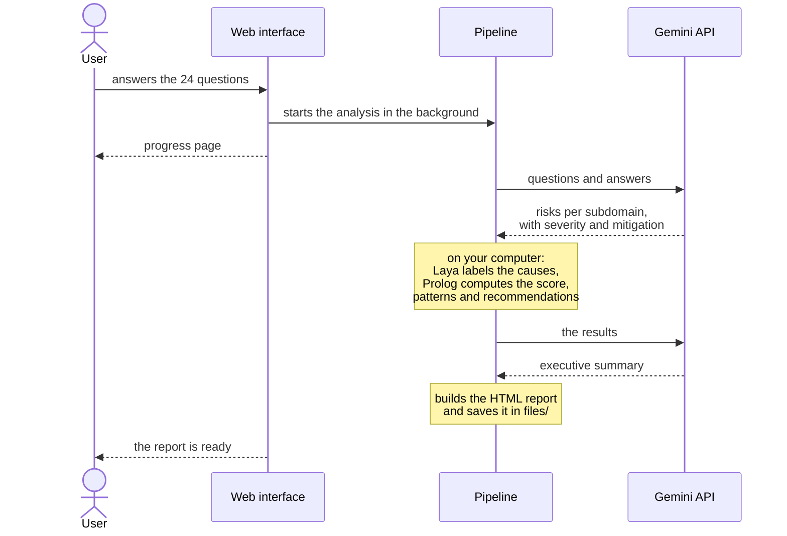

## 1. Questionnaire

24 questions in English or Italian (`files/questions_en.json`, `files/questions_it.json`), each tied to a
subdomain of the MIT Domain Taxonomy ([the taxonomies](taxonomies.md)). Some answers open follow-up
questions. The answers stay in your browser until you start the analysis, after a page that reviews them
all; then they are saved in `files/answers/`. The name you may give the system goes with them, for the
report: it never reaches the LLM. While the analysis runs, its page shows the step in course, and at the
end the main results, with the report and an archive of its data.

  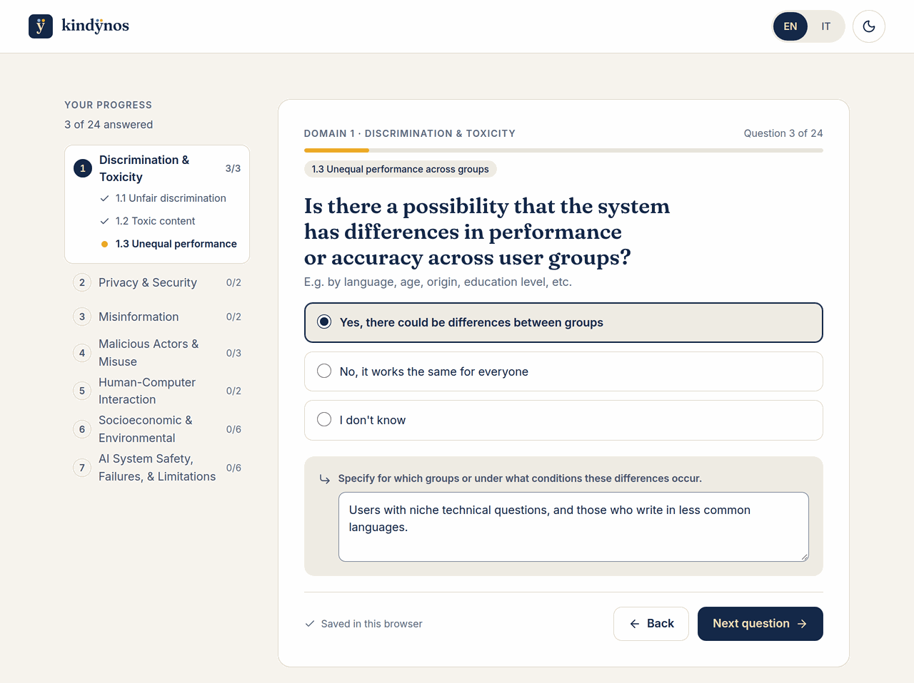
  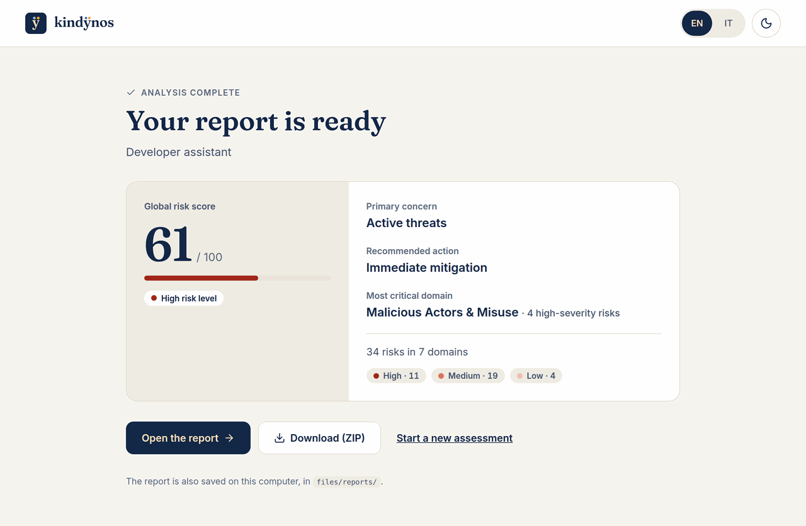

## 2. Domain analysis (LLM)

The domain analyzer sends the questions and answers to an LLM (Gemini), which replies following a JSON
schema. For each subdomain it writes the risks the answers point to, each with a title, an explanation, a
severity (low, medium or high) with its rationale, and a mitigation. Output: `files/analysis/domain/`.

## 3. Causal analysis (local model)

Each risk is labeled along the three axes of the MIT Causal Taxonomy: who or what causes it (entity),
whether the harm is intended (intent) and when it occurs (timing). The labels come from
[laya-kindynos-causal](https://huggingface.co/MicheleStingo/laya-kindynos-causal), a small model that runs
on the CPU, in about 2 seconds per risk on a laptop. It reads the subdomain, the title and the explanation
of the risk, and gives a calibrated probability for each value.

In the report each label carries the MIT definition of its value, the model's confidence and the next most
likely value. An LLM can label the causes instead ([configuration](configuration.md#the-causal-model)).
Output: `files/analysis/causality/`.

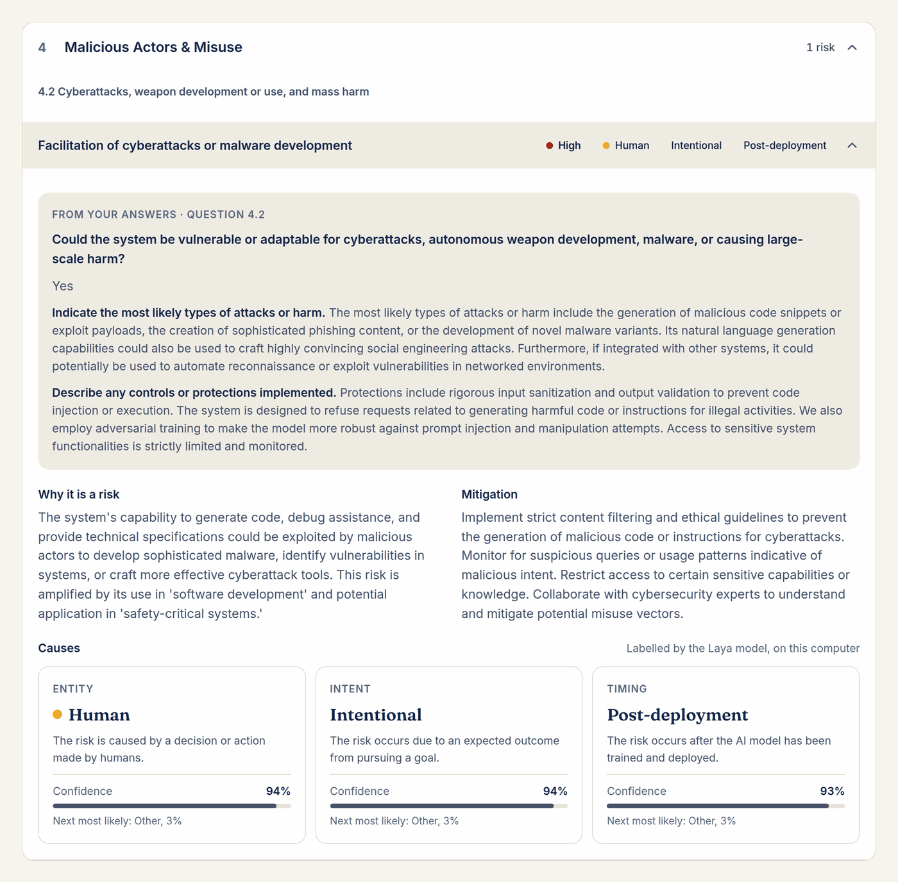

## 4. Heuristic analysis (Prolog)

Expert rules written in Prolog (`agents/heuristic_analyzer/rules.pl`) reason on the facts from the previous
steps, such as the severity and the causes of each risk. They:

- compute a global risk score and a risk level (critical, high, medium or low);
- identify the primary concern, for example active threats or operational issues;
- flag the domains that need urgent attention and recommend actions;
- find patterns across the risks, such as how many are intentional threats or unintended AI failures.

The rules encode knowledge that the taxonomies alone do not capture, and they can be extended
([below](#extending-kindynos)). Output: `files/analysis/heuristic/`.

## 5. Report (LLM and HTML)

The LLM writes an executive summary from the heuristic results, then Kindynos builds the HTML report in the
language of the questionnaire, titled with the name of the system when you gave one:

- **key findings**: the global score and risk level, the primary concern and the recommended action, the
  domains with the most high-severity risks, and the alerts of the rules, each said in words;
- **summary**: the executive summary, beside the risks at a glance, by severity and by cause;
- **charts**: the risks of each domain by severity; how the risks come about, from their entity to their
  intent and timing; the alert and safety profile, eight indices on five axes; the risk patterns of the
  rules, by group and by cause;
- **all the risks**: by domain and subdomain, with a search and filters by severity and cause; each with
  the question and answer it comes from, why it is a risk, its mitigation, and its causes with their MIT
  definitions.

The report is one HTML file, under 1 MB, with its code, fonts and logo inside: it opens offline, from the
disk or from the web interface, works from the keyboard and on a phone, and has a light and a dark theme.
*View data* opens its data as JSON; from the web interface, *Download (ZIP)* saves it with the answers and
the analyses. Output: `files/reports/`.

### What a report looks like

From an example analysis. In the report, the charts are interactive.

  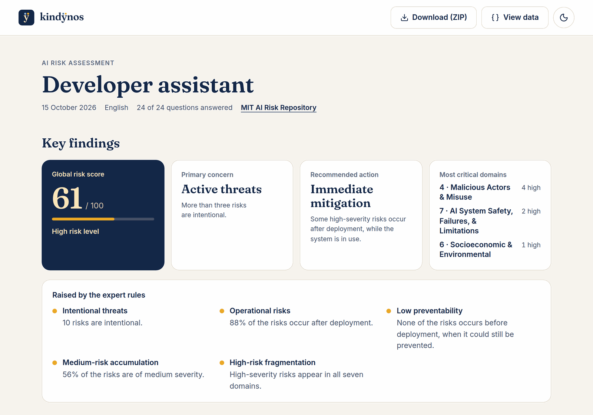 
  <em>The key findings: the global risk score and its level, the primary concern, the recommended action,
  the most critical domains and the alerts of the expert rules.</em>

   
  <em>The executive summary, written by the LLM, beside the risks at a glance: by severity, and by who or
  what causes them.</em>

  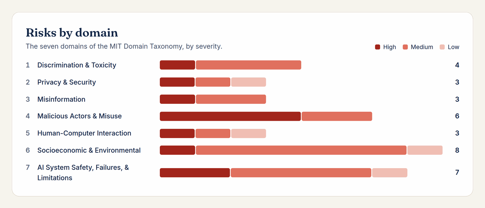 
  <em>The risks of each domain of the MIT Domain Taxonomy, by severity.</em>

  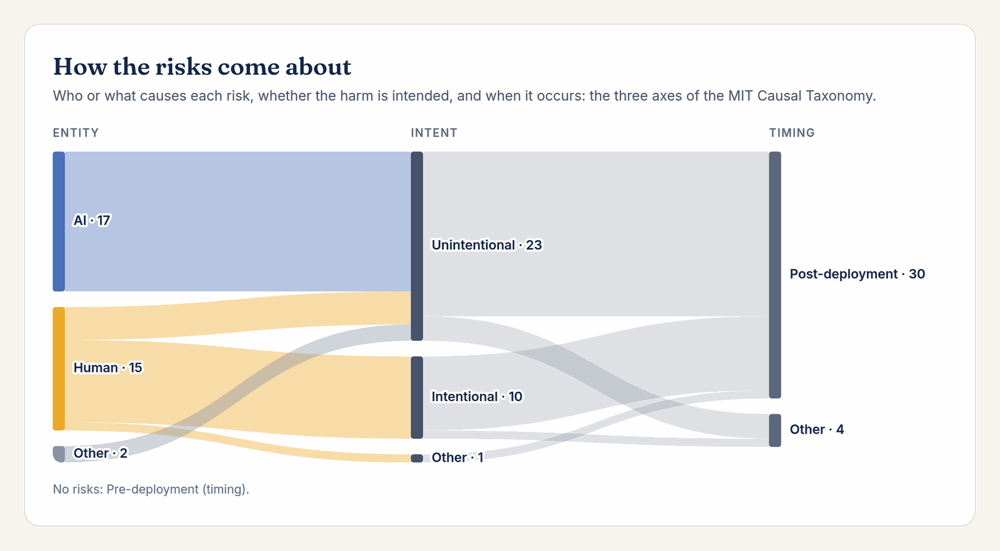 
  <em>How the risks come about: who or what causes them, whether the harm is intended, and when it
  occurs.</em>

  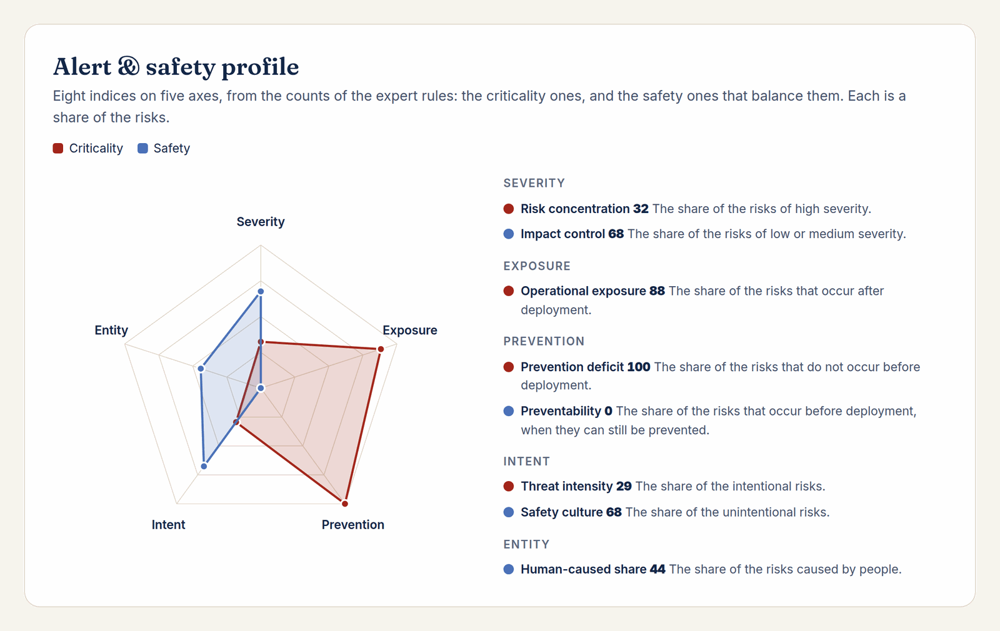 
  <em>The alert and safety profile: eight indices on five axes, each a share of the risks, such as the
  high-severity or the intentional ones.</em>

  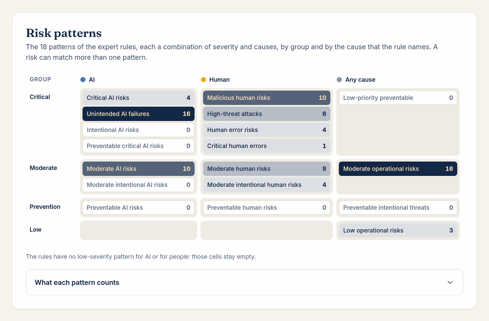 
  <em>The risk patterns found by the Prolog rules, such as unintended AI failures or malicious human risks,
  and how many risks fall in each.</em>

  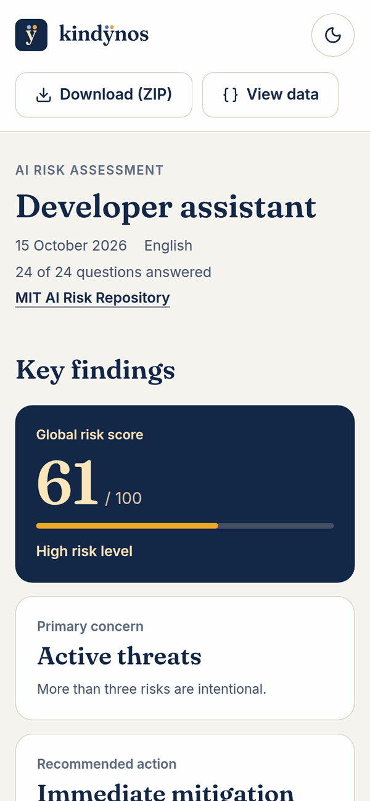
  &nbsp;
  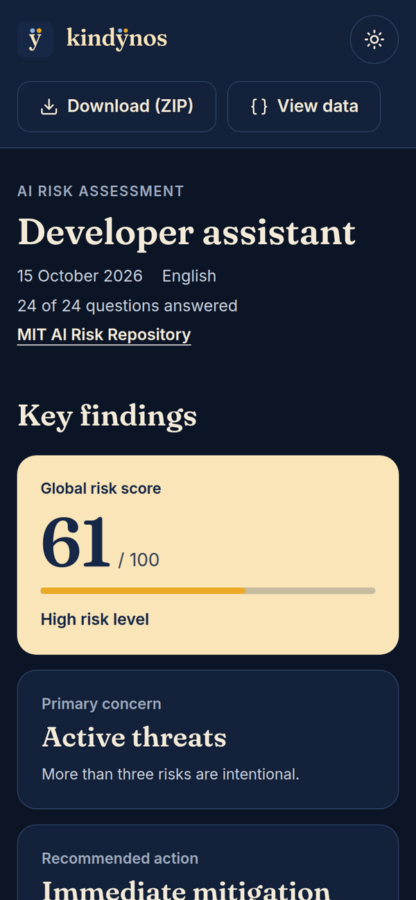 
  <em>On a phone, in the light and the dark theme.</em>

## Where the results go

All the files of a run share its id, from `answers_<run_id>.json` to `ai_risk_report_<run_id>.html`.

| Folder | Content |
|---|---|
| `files/answers/` | the answers of each questionnaire |
| `files/analysis/domain/`, `causality/`, `heuristic/` | the output of each step, as JSON |
| `files/reports/` | the HTML reports and their metadata |
| `files/jobs/` | the state of each analysis started from the web interface |

Thanks to `files/jobs/`, after a restart the page of an analysis still shows how it ended, and marks those
the restart cut short as interrupted.

## Extending Kindynos

- **Rules**: edit or add Prolog rules in `agents/heuristic_analyzer/rules.pl` to fit the analysis to a
  sector, a regulation or an organization.
- **Steps**: each step is a LangGraph graph, and `agents/orchestrator.py` chains them; a new agent joins the
  pipeline there.
